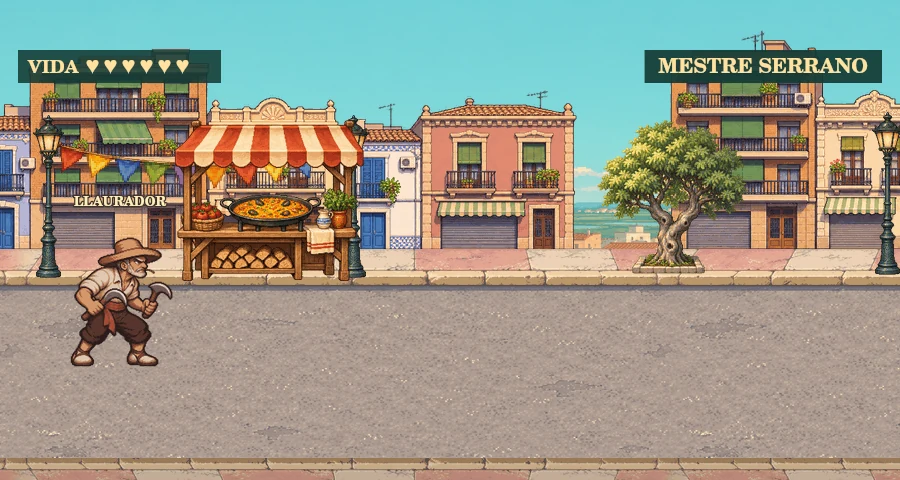
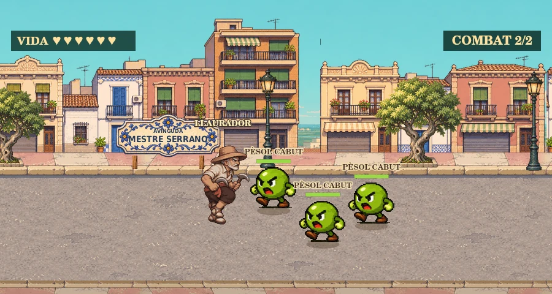
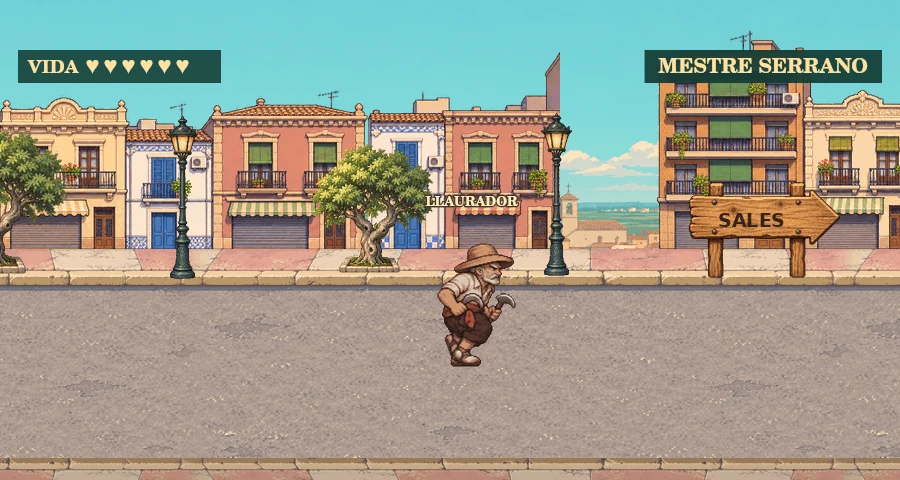

# Acto 1 — La persecució dels ingredients
## Subfase 1.1: Avinguda Mestre Serrano

La paella iba a prepararse al final de la Avinguda Mestre Serrano en Sueca. Los ingredientes son robados y el Llaurador sale tras los ladrones.

**Alcance de este prototipo:** un recorrido horizontal de 2.680 px con decorado ilustrado, cámara que acompaña al jugador, dos encuentros al alcanzar posiciones concretas y aviso **«TIRA-LI! →»** cuando se despeja el camino. No hay oleadas automáticas por temporizador. Los 2 y 3 Pèsols que se encuentran respectivamente comparten la IA y el atlas aprobado 04C. Sus corbelladas y el Remolí pueden alcanzar a varios objetivos, cada uno una sola vez por impacto.

**Reglas:** los encuentros se activan cuando el primer Pèsol de cada grupo entra en el borde derecho de la pantalla, gracias al avance horizontal del jugador (nunca por temporizador ni por proximidad muy corta). La IA lo persigue desde ese mismo momento. El avance queda bloqueado temporalmente en X=1040 y X=2010 hasta derrotar a todos. La cámara sigue horizontalmente al Llaurador durante los dos encuentros. Se permite retroceder, pero los encuentros completados no reaparecen. El progreso termina en una pantalla de transición «Cap a l’Església de Sales». El saco de arroz todavía **no** se recupera: eso corresponde al final del acto en La Via.

**Controles:** cruceta táctil en iPad, combo ×4 y Remolí; flechas/WASD, J/espacio y K en escritorio. El menú de ajustes permanece disponible.

La versión 1.1d integra el primer escenario ilustrado. La prueba artística en el iPad del propietario queda pendiente.

### Recorrido acordado para el acto completo
1. Avinguda Mestre Serrano (esta entrega)
2. Església de Sales
3. Carrer Mare de Déu
4. Plaça de l’Ajuntament
5. Carrer Sequial
6. La Via (jefe del acto)

**Fuera de alcance:** la persecución en Derbi hacia la playa, la Albufera y las PR #30 y #31, todavía independientes.

### Pruebas
Ejecutar `npm test`. `tests/avenida.test.cjs` valida con un reloj manual la transición de estados, que los encuentros no aparecen sin avanzar, el límite del escenario, la cámara, el daño múltiple, el mensaje «TIRA-LI!», el reinicio y el cierre del primer tramo. Sigue pendiente una prueba manual en un iPad físico.

### Ajuste de cámara y enemigos precolocados
Los cinco Pèsols están situados en sus coordenadas desde el inicio del tramo. Están en reposo hasta que comienzan a asomar por el borde visible de la cámara: entonces se activa su IA y comienzan a perseguir al Llaurador sin teleportarse. La cámara únicamente desplaza X y nunca aplica temblores verticales; también en combate sigue lateralmente al Llaurador con movimiento suavizado. Se redondea la posición de la cámara al dibujar para evitar parpadeos del pixel art.

### Corrección 1.1c — cabecera estable
Título visible abreviado a «Mestre Serrano», con objetivo breve y anchuras/alturas de cabecera predefinidas. La aparición del combate ya no cambia el número de líneas ni desplaza el Canvas o los controles táctiles.

### 1.1d · Escenario ilustrado

El recorrido arranca junto a la parada de paella y los banderines. La placa de cerámica identifica la avenida durante el segundo encuentro. Al final aparece la flecha de madera hacia Sales. La recreación interpreta la calle para el juego. Como referencia de ambientación, la prensa local documenta la celebración de una paella gigante en la avenida. [Hemeroteca de El Seis Doble](https://hemeroteca.e6d.es/noticias/hui-a-sueca-paella-gegant-a-lavinguda-mestre-serrano)

Las cuatro ilustraciones generadas para esta misión se recuperaron de la sesión artística anterior. Los PNG de juego se han recortado, rotulado y reducido a su resolución de uso. Las dos hileras de fachadas y los seis adornos comparten sus respectivos atlas.

| PNG en `assets/escenarios/mestre-serrano/` | Contenido | Movimiento |
| --- | --- | --- |
| `horitzo.png` | Cielo, nubes, arrozales, tejados y campanario | 11 % de la cámara |
| `facanes.png` | Bloques con balcones, casas bajas, persianas, toldos y comercios | 76 % |
| `paviment.png` | Acera trasera, bordillo, calzada y acera delantera. El módulo enlaza horizontalmente y el bordillo delantero queda por debajo del límite de los pies | 100 % |
| `decorats.png` | Árbol, farola, parada con paella, banderines, placa «Avinguda Mestre Serrano» y flecha «Sales» | 100 % |

`src/avenida.js` define los recortes y sus posiciones en el mundo. `src/escenario.js` carga cada PNG una vez, redondea el desplazamiento de cada plano y solo dibuja piezas visibles. Los cuatro archivos suman 401.838 bytes. El motor sigue dibujando después los actores por su posición Y y, al final, el HUD. Los rótulos llevan un contorno para conservar su lectura sobre las fachadas. Otro escenario puede reutilizar el mismo dibujante cambiando las láminas, los recortes y las capas.

| Fiesta de la paella | Segundo encuentro | Salida hacia Sales |
| --- | --- | --- |
|  |  |  |

Las capturas proceden del bucle real de juego en Canvas 2D. La comprobación WebKit en CI carga los cuatro PNG, pulsa los controles, entra en combate, verifica la posición del Canvas y la botonera y prueba el reinicio. La fluidez y el tacto con dos pulgares quedan para la revisión física.
